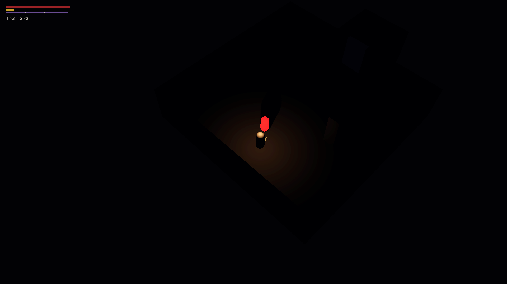

# Eldritch Depths

RPG de ação em 3D com câmera fixa inclinada e horror cósmico. A sanidade do herói é a percepção da realidade: quanto mais ela cai, mais o Véu se rasga e o mundo mostra o que esconde.

## Estado atual

Protótipo do **Bloco 1A** ("Tela e sensação", trilha de jogo): uma sala em blocos cinzas, câmera fixa inclinada, luz ao redor do herói, combate contra um inimigo comum, HUD mínimo e uma parede do Véu que se dissolve quando a sanidade cai. Herói e inimigo são provisórios (cápsulas). A arte de verdade vem no Bloco 1B.



## A história

Dizem os antigos que a mente dos homens é um véu, tecido para esconder o que habita as profundezas. Enquanto está inteiro, cumpre seu ofício. Quanto mais fino, mais se vê.

Outrora o Reino de Solvéria dormia em paz sob as estrelas. Mas na noite da Maré Astral os astros se alinharam, o chão do Santuário das Cinzas fendeu-se e abriu-se o Poço sem fundo. Dele subiu o sonho de Oth-Ysael, Aquele Que Sonha Sob o Poço, que arrastou para as trevas a Princesa Aurélia, derradeira herdeira de Solvéria. Desde aquela noite, nenhuma aurora nasceu inteira sobre o reino.

Tu és um andarilho, e teu nome só tu o dás. À beira da fenda, Illyria, a Guardiã das Cinzas, última a velar as chamas antigas, abençoa-te e manda-te descer. Andar por andar hás de ir, que os caminhos mudam a cada descida e a cada cinco deles há quem guarde a passagem. Leva a espada, os frascos de sangue e o láudano, e não te fies no que vires lá embaixo.

Pois lá embaixo o juízo não é só coragem: é o que teus olhos alcançam. Quanto mais ele míngua, mais o Poço se desvela. Muros de pedra desfazem-se em passagens, andares escondidos abrem-se, e do outro lado do Véu jazem fragmentos de poder que ninguém de juízo inteiro jamais tocou. Muitos já trocaram a própria humanidade por esse olhar.

Mas o Véu não se rasga de graça. Quando a derradeira fibra cede, algo nasce de dentro de ti: um Senhor de lacaios, cercado das criaturas que só o outro lado conhece. Vence-o e segue descendo. Cai, e o Poço ganha mais um.

Três descem em busca da Princesa. O Cavaleiro encapuzado, de armadura escura e espada longa. O Mago, que lê nas estrelas o que o Poço esconde. E o Demônio, que um dia perdeu o Véu inteiro, venceu a coisa que dele nasceu e a traz agora consigo: senhor de lacaios, invoca as criaturas do outro lado.

## Requisitos

- [Godot](https://godotengine.org/) **4.7.2** (o executável `godot` no `PATH`).
- Placa de vídeo com **Vulkan**: o projeto usa o renderizador Mobile.

## Como rodar

A partir da raiz do repositório:

```bash
godot --path .
```

Ou abra o `project.godot` no editor do Godot e aperte **F5**.

Para começar com a sanidade baixa (a vinheta fecha e a parede do Véu já se abre):

```bash
godot --path . -- --sanity=20
```

## Controles

| Ação | Teclado e mouse | Controle |
|------|-----------------|----------|
| Andar | W A S D | analógico esquerdo |
| Mirar | cursor do mouse | analógico direito |
| Atacar | botão esquerdo do mouse | X (Xbox) / □ (PlayStation) |
| Esquivar | Espaço | A (Xbox) / ✕ (PlayStation) |
| Parry | botão direito do mouse | gatilho esquerdo (LT / L2) |
| Frasco de sangue (vida) | 1 | D-pad ↓ |
| Láudano (sanidade) | 2 | D-pad ↑ |

O jogo troca sozinho entre teclado e controle conforme o que você usa. As teclas valem pela posição física (WASD fica no lugar em qualquer layout de teclado). O mapa também reserva Q / Y (magia) e E / B (interagir), que ainda não fazem nada neste bloco.

## Teclas e argumentos de depuração

| O quê | Efeito | Onde vale |
|-------|--------|-----------|
| F7 | alterna entre o enquadramento atual e um mais próximo | todas as builds |
| F9 | derruba a sanidade em 20 | só na build de depuração |
| `-- --sanity=N` | começa com a sanidade em N (só para baixo) | só na build de depuração |
| `-- --autoplay` | o herói joga sozinho (anda, ataca, esquiva) e o inimigo reaparece 2 s depois de morrer; serve para medir fps | todas as builds |

Os argumentos vão depois de `--`, por exemplo `godot --path . -- --autoplay`.

## Testes e desempenho

```bash
tools/test.sh
```

Roda todos os testes sem janela. Quando tudo passa, a última linha é `OK: <n> testes` e o código de saída é 0; quando algo falha, cada falha aparece numa linha `FAIL` e o resumo é `FALHOU: <x> de <n>`.

```bash
tools/measure_fps.sh mobile
tools/measure_fps.sh gl_compatibility
```

Abre o jogo em 1920×1080 no modo `--autoplay` por 30 s, descarta os 5 primeiros segundos e imprime `renderer=<r> media=<x> minimo=<y>`. Com vsync o número fica preso à taxa do monitor (60 num monitor de 60 Hz), então ele mostra se a meta é cumprida, não quanto sobra.

## Estrutura e documentação

O contexto do projeto mora em [`context/`](context/index.md): o [`index.md`](context/index.md) diz o que cada arquivo tem, e o [`arquitetura.md`](context/arquitetura.md) descreve a stack, as pastas, as camadas de colisão e os testes. O design aprovado está na [spec](docs/superpowers/specs/2026-11-14-eldritch-depths-3d-design.md), e o andamento do Bloco 1A está no [plano](docs/superpowers/plans/2026-11-14-tela-e-sensacao-trilha-jogo.md) e no [ledger](docs/superpowers/plans/2026-11-14-tela-e-sensacao-ledger.md), em `docs/superpowers/`.
